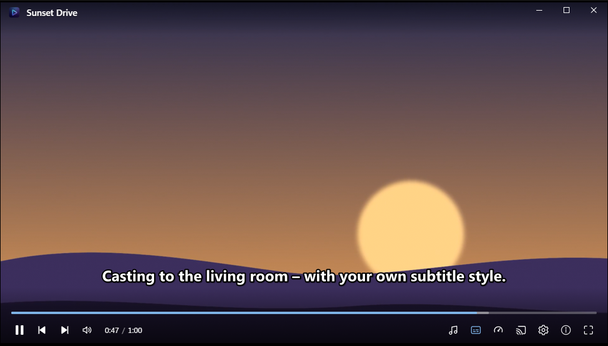

# Kast

**English** | [Deutsch](README.de.md)

A lean, portable video player for Windows that plays almost any format and **casts to Chromecast, DLNA and AirPlay** devices.



- Plays MP4, M4V, MKV, AVI, MOV, WebM, WMV, TS and more – powered by [mpv](https://mpv.io) with hardware decoding
- **Cast button** in the player: Chromecast / Google TV, DLNA smart TVs and AirPlay receivers on your network
- Choose the **audio track** and **subtitles** (embedded or external `.srt`/`.ass`/`.vtt`, loaded automatically), on the PC and on the TV
- **Subtitle style** editor: font, size, color, bold/italic, border, shadow, background box, position – applied live
- Playlist from the folder, recently opened files, resume where you left off, subtitle/audio delay, playback speed, screenshots, URLs
- **Keyboard shortcuts** you can change in the settings
- Portable: no installation, settings in `settings.json` next to the EXE
- English and German UI (follows the Windows language), light and dark theme, Windows accent color

## Download

- **[Latest release](https://github.com/naderi/kast/releases/latest)** – download `Kast-<version>-win-x64.7z`, unpack it into a folder of your choice and run `Kast.exe`.
- Or with [Scoop](https://scoop.sh):

  ```
  scoop bucket add naderi https://github.com/naderi/scoop-bucket
  scoop install naderi/kast
  ```

## Using it

- **Open** a video with the button, by drag & drop, from the command line or (optionally) with "Open with" in Explorer
- **Mouse:** click = pause, double-click = fullscreen, wheel = volume, drag the video to move the window
- **Keys** (all changeable in the settings): Space pause · ←/→ 5 s (Shift: 1 s) · ↑/↓ volume · M sound on/off · F fullscreen · S subtitles on/off · V next subtitle track · A next audio track · Z/X subtitle delay · Ctrl+Plus/Minus speed (Ctrl+0 normal) · Ctrl+Shift+S screenshot · N/P next/previous · Ctrl+O open · Ctrl+R recent files · Ctrl+, settings
- The window keeps the video's aspect ratio, so there are no black bars; *Fill window (crop)* in the ⚙ menu fills it completely

## Casting

Click the cast button in the control bar at the bottom and pick a device. The video on the PC pauses, and the player controls – pause, seek, volume, audio track, subtitles, subtitle delay and style – now control the TV. Stopping continues on the PC where the TV left off.

Kast streams the file from the PC over your local network:

| Device | Plays directly | Converted on the fly |
|---|---|---|
| Chromecast / Google TV | MP4 / WebM with H.264, VP8 (HEVC/VP9 on 4K models) and AAC, MP3, Opus, FLAC | other containers are repacked without quality loss; other video codecs are re-encoded with the GPU encoder (NVENC, Quick Sync, AMF or Media Foundation) |
| DLNA TVs | MP4 with H.264 and AAC/MP3 | repacked or re-encoded to MPEG-TS |
| AirPlay | MP4 with H.264/HEVC and AAC | repacked or re-encoded to HLS |

Subtitles are drawn by the Chromecast itself, with your subtitle style. DLNA and AirPlay devices get them burned into the picture (also used for image subtitles such as PGS on the Chromecast).

Notes:
- PC and device must be in the same network. If nothing appears on the TV, allow Kast in the Windows firewall for private networks.
- AirPlay: devices that require pairing with a PIN (recent Apple TVs) are not supported yet.

## Options

The ⚙ menu → *Settings*:

- Language, theme
- Resume, hardware decoding, show subtitles automatically, preferred audio and subtitle languages (default: English, then German)
- *Prevent sleep while casting* – the TV streams from the PC, so sleep would stop playback; the screen may still turn off
- Screenshot folder (default: `Pictures\Kast`)
- Subtitle style
- *Integration* – all off by default, Kast changes nothing outside its folder unless you switch them on: "Open with" for video files, desktop shortcut, start menu shortcut
- Updates

## Program updates

Kast updates itself from the [releases of this repository](https://github.com/naderi/kast/releases):

- Once a day it looks for a new version in the background (can be switched off: *Check automatically (once a day)*). A new version lights an orange dot on the ⓘ button.
- In the about window (ⓘ): *Check for updates* → *Download update* → *Restart & update*.
- A download is only used if its signature (`.sig`) matches the key built into Kast; anything else is rejected. `settings.json` stays untouched.
- Installed with Scoop, Kast only points to `scoop update kast`.

## License

Freeware – free to use, but **not for sale**. See [LICENSE](LICENSE).
The included `libmpv-2.dll` (mpv) and `ffmpeg.exe` (FFmpeg) are separate LGPL components, see [LICENSE](LICENSE) and `THIRD-PARTY-NOTICES.txt`.

© 2026 [Ali Naderi](https://github.com/naderi) · [digitalent.dev](https://digitalent.dev/en/)
